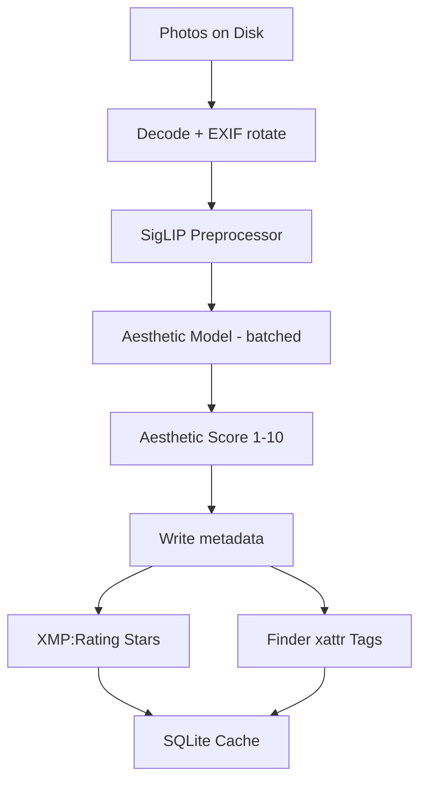

# Image Classifier

[**View Project Page**](https://wenzelt.github.io/image-classifier/)

> **Stop sifting, start seeing.** Automatically score every photo in your library for aesthetic quality. Writes XMP star ratings directly into metadata so macOS Finder sorts your best shots to the top — instantly.

---

## The Story

"I was tired of sifting through thousands of images to find the gems. I wanted a software shortcut. I have over 100,000 images, but who ever looks at them again? So I automated it. Now, I use a **SigLIP model by Google** to score aesthetics directly in Finder using tags and EXIF stars."

---

## Key Features

- **State-of-the-Art AI**: Uses the `aesthetic-predictor-v2-5` model (SigLIP-based) to score images on a nuanced 1–10 scale.
- **Apple Silicon Optimized**: Fully supports **MPS (Metal Performance Shaders)** for fast inference on Mac M1/M2/M3 chips. NVIDIA GPUs (CUDA) are used when present.
- **Finder Integration**: Beyond metadata, it applies native macOS Finder tags (e.g., "7.4") and standard XMP Star Ratings.
- **Built for Scale**:
  - **Parallel pipeline**: Images are decoded and metadata is written on worker threads while the model scores batches, so the GPU is not left waiting on disk and `exiftool`.
  - **SQLite Caching**: Skips already-scored images. When everything is already scored, the run finishes instantly without loading the model.
  - **Recursive Scanning**: Process entire folder hierarchies in one go.
  - **Safe resume**: An image is recorded in SQLite only *after* its metadata has been written, so a failure can never cause an unrated photo to be skipped, and an interrupted run (Ctrl+C) simply picks up where it left off.
- **Robust & Reliable**: Handles truncated JPEGs, unusual colorspaces and EXIF orientation (portrait phone photos are scored upright), and provides a detailed failure log for unreadable files. One bad file never stops a run.
- **Safe by Default**: `--dry-run` previews scores without touching a single file; file modification times are preserved; Photos library bundles are never entered.
- **Performance Profiling**: Use the `--profile` flag to see exactly where your time goes (Load vs. Inference vs. Writing).

---

## How it Works



1. **Scan**: Identifies all supported images (`.jpg`, `.jpeg`, `.png`, `.tiff`, `.webp`, `.heic`), skipping hidden files and folders.
2. **Score**: Decodes images on worker threads, then runs them through the SigLIP model in batches on your GPU/CPU.
3. **Tag**: Updates the file's metadata using `exiftool` (XMP rating) and, on macOS, `xattr` (Finder tag). Your existing Finder tags are preserved.
4. **Persist**: Only once the metadata is written, saves the raw score and timestamp to a local SQLite database.

---

## Star Rating Scale

We map the 1–10 aesthetic score to a standard 1–5 star system:

| Score | Stars | Label | Finder Experience |
| :--- | :--- | :--- | :--- |
| **8.5 – 10** | ★★★★★ | Exceptional | The absolute best of your library. |
| **7.0 – 8.5** | ★★★★☆ | Great | High-quality shots worth keeping. |
| **5.5 – 7.0** | ★★★☆☆ | Good | Decent photos, standard quality. |
| **4.0 – 5.5** | ★★☆☆☆ | Below Average | Might be blurry or poorly composed. |
| **< 4.0** | ★☆☆☆☆ | Poor | Safe to archive or delete. |

---

## Installation

### 1. Requirements
- **macOS** (XMP ratings and Finder tags) or **Linux** (XMP ratings only; Finder tags are a macOS feature and are skipped automatically).
- **Python ≥ 3.11**
- [**uv**](https://github.com/astral-sh/uv) (Fast Python package manager)
- [**exiftool**](https://exiftool.org/) (For metadata writing)

### 2. Setup
```bash
# Install dependencies (macOS)
brew install uv exiftool
# ... or on Debian/Ubuntu: sudo apt install libimage-exiftool-perl, and install uv separately

# Clone and sync
git clone https://github.com/wenzelt/siglip-aesthetics-scoring-macos
cd siglip-aesthetics-scoring-macos
uv sync
```

The first scoring run downloads the model (~1.5 GB) to `~/.cache/huggingface`.

---

## Usage

> **Heads up: this tool modifies your image files in place** (it embeds an XMP rating). Keep a backup of anything irreplaceable, and consider a `--dry-run` first.

### Basic Scoring
Score a single folder (skips images already in the database):
```bash
uv run classify ~/Pictures/Vacation
```

### Advanced Options
```bash
# Preview: score everything and show the distribution, change nothing
uv run classify ~/Pictures --dry-run

# Process subfolders recursively
uv run classify ~/Pictures --recursive

# Re-score everything (overwrites existing ratings)
uv run classify ~/Pictures --force

# Show performance profiling after the run
uv run classify ~/Pictures --profile
```

### All Options

| Option | Description |
| :--- | :--- |
| `--recursive` | Scan subdirectories recursively. |
| `--force` | Re-score images that are already in the database. |
| `--dry-run` | Score and report, but write nothing: no image files, no database rows. |
| `--no-finder-tags` | Write only the XMP star rating, not the macOS Finder score tag. |
| `--workers N` | Threads used to decode images and write metadata (default: up to 4). |
| `--batch-size N` | Images scored per model call (default: 8). Lower it if you run out of memory. |
| `--db PATH` | SQLite cache location (default: `~/.local/share/image-classifier/classify.db`). |
| `--profile` | Print per-phase timings and wall-clock throughput. |
| `--version` | Print the version and exit. |

Exit codes: `0` on success (individual unreadable images are reported and logged but do not fail the run), `1` for setup errors (missing folder, model could not be loaded, ...), `130` if interrupted with Ctrl+C.

### Tuning for large libraries
The defaults are a good start. If `--profile` shows `Exiftool` dominating, raise `--workers` (metadata writes are independent subprocesses and scale with cores). If `Infer` dominates and you have memory to spare, raise `--batch-size`. Remember that the per-image phase times overlap when running several workers, so judge speed by the reported images/s.

### View Results in Finder
1. Open your folder in **Finder**.
2. Switch to **List View** (`Cmd + 2`).
3. Right-click the column header and enable **Rating**.
4. Click the **Rating** column to sort descending.

---

## Supported Formats and What Is Skipped

- **Scored**: JPEG, PNG, TIFF, WebP and HEIC. These are exactly the formats `exiftool` can write XMP into.
- **Not supported**: BMP. `exiftool` cannot write metadata to BMP files, so they would be scored but never rated.
- **Skipped**: hidden files and folders (names starting with `.`, which includes macOS `._` resource-fork files) and photo-library bundles (`.photoslibrary`, `.photolibrary`, `.aplibrary`). The apps that own those libraries track every file in their own database; rewriting files behind their back can corrupt the library. To score photos from Apple Photos, export them to a normal folder first. Pointing the tool directly at such a bundle is refused.

---

## Troubleshooting

- **"exiftool is required but not installed"**: install it (`brew install exiftool`). It is not needed for `--dry-run`.
- **"could not load the aesthetic model"**: the first run needs an internet connection to download the model; interrupted downloads resume on the next attempt.
- **Some images show under "Recent Failures"**: they were unreadable (corrupt or truncated beyond recovery) or `exiftool` refused them. Details are in the log. Failed images are retried on every run, and a later success clears the failure record.
- **Scores changed after upgrading**: images are now rotated according to their EXIF orientation before scoring (previously portrait photos were scored sideways). Use `--force` to re-score an existing library.
- **No Rating column / ratings not appearing in Finder**: Spotlight may still be indexing the files. Give it a few minutes, or run `mdimport <folder>`.

---

## Project Structure

- `src/image_classifier/`
  - `classifier.py`: Model loading, image decoding and SigLIP inference logic.
  - `processor.py`: The parallel scoring pipeline (decode, batch inference, metadata writes, persistence).
  - `metadata.py`: `exiftool` and `xattr` bridge.
  - `database.py`: SQLite persistence layer.
  - `scanner.py`: Efficient file system crawler.
  - `report.py`: Rich terminal summaries and tables.
  - `logging_utils.py`: Rotating error log.
  - `main.py`: CLI argument handling and progress display.

---

## Development

```bash
uv sync --group dev

uv run pytest                              # tests + coverage
uv run ruff format --check src/ tests/     # formatting
uv run ruff check src/ tests/              # lint
uv run mypy src/                           # types
```

The test suite stubs the model, so it needs no GPU or download. The integration tests in `tests/test_integration.py` drive the real `exiftool` and are skipped when it is not installed; the Finder-tag test runs only on macOS. CI runs on Linux and macOS.

---

## Data & Privacy

All processing is **100% local**. No images are ever uploaded to the cloud (the only network access is the one-time model download).
- **Database**: `~/.local/share/image-classifier/classify.db` (override with `--db`)
- **Logs**: `~/.local/share/image-classifier/classify.log` (rotated automatically)

The model is loaded with `trust_remote_code=True`, as required by the upstream checkpoint.

---

## Acknowledgments

- [**aesthetic-predictor-v2-5**](https://github.com/discus0434/aesthetic-predictor-v2-5) for the excellent SigLIP-based model.
- [**Google SigLIP**](https://huggingface.co/docs/transformers/model_doc/siglip) for the underlying vision transformer.
- [**exiftool**](https://exiftool.org/) for being the gold standard of metadata manipulation.
